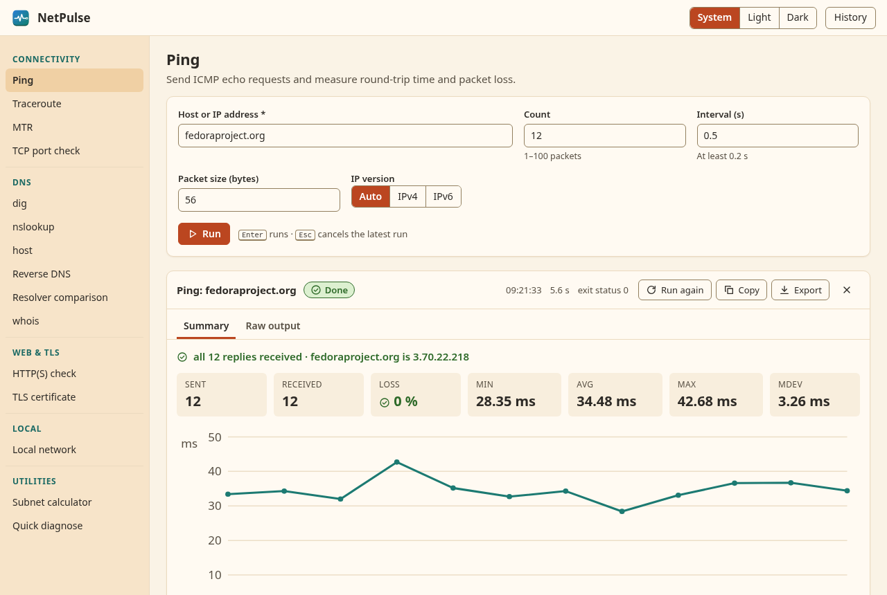
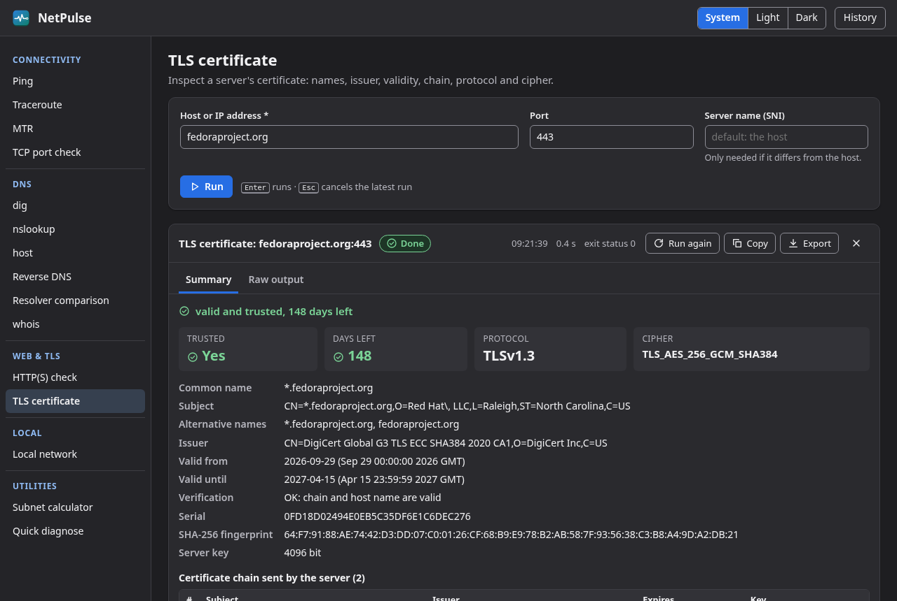

# NetPulse

**Network diagnostics in one calm window.** NetPulse runs the real network tools on your
Linux computer (ping, traceroute, mtr, dig, whois, curl, openssl and more), shows their
output live and turns it into an easy-to-read summary.

| Light | Dark |
|---|---|
|  |  |

- Runs locally, for one user. No account, no cloud, **no telemetry, no update checks**.
- Works offline (apart from the network tests themselves). All assets ship in the package.
- A warm, cheerful pastel light theme, a dark theme and System mode; WCAG 2.1 AA contrast, full keyboard use.
- Opens in a native GTK window, or in your web browser if GTK/WebKit isn't installed.

## Features

| Group | Tool | What you get |
|---|---|---|
| Connectivity | **Ping** | Sent/received, loss, min/avg/max/mdev and a live RTT chart with lost packets marked |
| | **Traceroute** | Hop table that fills in live (UDP/ICMP without root; falls back to `tracepath`) |
| | **MTR** | Loss and latency per hop over several cycles (`mtr --json`) |
| | **TCP port check** | Open / closed / filtered and connect time for up to 10 ports on one host |
| DNS | **dig** | Answer/authority/additional sections, TTLs, flags, status, query time and server; `+short`, `+trace`, `+dnssec`, TCP |
| | **nslookup**, **host** | Quick lookups with a parsed summary |
| | **Reverse DNS** | PTR lookup for an IPv4 or IPv6 address |
| | **Resolver comparison** | One query to several resolvers in parallel; differences highlighted (handy for propagation checks) |
| | **whois** | Registrar, dates, name servers, organisation/netname and abuse contact |
| Web & TLS | **HTTP(S) check** | Status, redirect chain, headers and a timing breakdown (DNS, connect, TLS, wait, transfer) |
| | **TLS certificate** | Subject, issuer, SANs, validity with days-to-expiry warning, protocol, cipher and chain |
| Local | **Local network** | Interfaces and addresses, routes and default gateway, DNS configuration, optional listening sockets |
| Utilities | **Subnet calculator** | IPv4/IPv6 network, mask, host range, size and subnet splitting (no network access) |
| | **Quick diagnose** | DNS A/AAAA, ping, traceroute and HTTP check for one host, as a one-page report |

Every tool has a form with sensible defaults, **Run** (<kbd>Enter</kbd>) and **Cancel**
(<kbd>Esc</kbd>), live raw output plus a **Summary** view, elapsed time and exit status,
and **Copy** / **Export** as TXT, JSON or Markdown. Several jobs can run at once. Every run
is saved to a searchable **history** that you can re-run, limit or clear.

## Requirements

Fedora Workstation (current releases), Python 3.12 or newer (standard library only).

| Needed for | Fedora package |
|---|---|
| ping, tracepath | `iputils` (required) |
| dig, nslookup, host | `bind-utils` (required) |
| traceroute | `traceroute` |
| MTR | `mtr` |
| whois | `whois` |
| HTTP(S) check | `curl` |
| TLS certificate | `openssl` |
| Local network | `iproute`, `systemd-resolved` |
| Native window | `python3-gobject`, `webkitgtk6.0` (optional: `libadwaita`) |

Missing tools are shown as "not installed" with the exact `sudo dnf install …` command.
To install everything at once:

```sh
sudo dnf install iputils bind-utils traceroute mtr whois curl openssl iproute systemd-resolved python3-gobject webkitgtk6.0
```

## Install

### From an RPM (GitHub release)

Download `netpulse-<version>.noarch.rpm` from the
[Releases](https://github.com/agent-denis/netpulse/releases) page, then:

```sh
sudo dnf install ./netpulse-*.noarch.rpm
```

NetPulse then appears in GNOME Activities. To remove it: `sudo dnf remove netpulse`.
Your settings and history (`~/.config/netpulse`, `~/.local/share/netpulse`) are kept; delete
those folders yourself if you want them gone.

### From COPR

Once a COPR project exists (see [Building in COPR](#building-in-copr)):

```sh
sudo dnf copr enable agent-denis/netpulse
sudo dnf install netpulse
```

### From source

```sh
git clone https://github.com/agent-denis/netpulse.git
cd netpulse
make run              # same as: PYTHONPATH=src python3 -m netpulse
```

## Usage

```text
netpulse                # native window if available, otherwise the default browser
netpulse --browser      # always use the web browser
netpulse --no-open      # only print the address (with access token)
netpulse --port 8765    # fixed port instead of a random one
```

Starting `netpulse` again while it runs brings the existing window to the front. In browser
mode NetPulse stops by itself about two minutes after you close the page. See `man netpulse`.

Keyboard: <kbd>Enter</kbd> runs the current form, <kbd>Esc</kbd> cancels the latest run,
<kbd>↑</kbd>/<kbd>↓</kbd> move through the tool list, <kbd>←</kbd>/<kbd>→</kbd> switch
between Summary and Raw output, <kbd>Ctrl</kbd>+<kbd>Q</kbd> quits the window.

## Security model

NetPulse runs network tools on your behalf, so its local web server is locked down:

- **Loopback only.** It listens on `127.0.0.1` on a random free port. Non-loopback
  addresses are refused.
- **Access token.** A new random token is created at every start and required on every API
  and live-output request. It is passed in the URL *fragment*, which browsers never send to
  servers, and then removed from the address bar.
- **Host and Origin checks** block DNS rebinding and requests from other web pages; a strict
  Content-Security-Policy forbids inline scripts and styles and any remote resources.
- **No shell, ever.** Tools are started with an argument list (`shell=False`). All input is
  validated on the server: hostnames (RFC 1123, IDN via punycode, look-alike "homoglyph"
  names rejected), IP addresses, allow-listed record types and options, clamped numbers.
  Values starting with `-` are refused and `--` is used where the tool supports it.
- **Limits.** Per-job timeouts, at most 8 jobs at once, an output size cap. Cancelling, a
  timeout or a closed page kills the whole process group; nothing is left behind on exit.
- **Output is text.** Tool output is never interpreted as HTML.
- **No root.** NetPulse never calls `sudo` or `pkexec`. Modes that need privileges (e.g.
  TCP traceroute) say so.

Please report vulnerabilities privately, see [SECURITY.md](SECURITY.md).

## Building the RPM

```sh
sudo dnf install make rpm-build rpmlint python3-devel pyproject-rpm-macros \
    python3-setuptools python3-pytest desktop-file-utils appstream ruff
make test     # offline test suite
make lint     # ruff, licence headers, rpmlint
make rpm      # build/rpmbuild/RPMS/noarch/netpulse-*.noarch.rpm
make srpm     # build/rpmbuild/SRPMS/netpulse-*.src.rpm
make mock     # clean build for the current Fedora (needs the mock package and group)
```

`make tarball` packs the **committed** state (`git archive HEAD`), so commit before
building.

### Building in COPR

The repository contains a [Packit](https://packit.dev) configuration (`.packit.yaml`).

1. Create a project named `netpulse` at <https://copr.fedorainfracloud.org>.
2. Install the [Packit GitHub app](https://github.com/marketplace/packit-as-a-service) on
   the repository and give the `packit` user build permission in the COPR project settings.
3. Pull requests now get test builds; publishing a GitHub release (tag `v1.2.3`) builds
   into your COPR project for all current Fedora releases.

Without Packit you can also upload the SRPM from `make srpm` in the COPR web interface.

## Contributing

Contributions are welcome. Please read [CONTRIBUTING.md](CONTRIBUTING.md) and the
[Code of Conduct](CODE_OF_CONDUCT.md). Changes are listed in [CHANGELOG.md](CHANGELOG.md).

## License

NetPulse is free software: you can redistribute it and/or modify it under the terms of the
GNU General Public License as published by the Free Software Foundation, either version 3
of the License, or (at your option) any later version. See [LICENSE](LICENSE).

SPDX-License-Identifier: `GPL-3.0-or-later`
